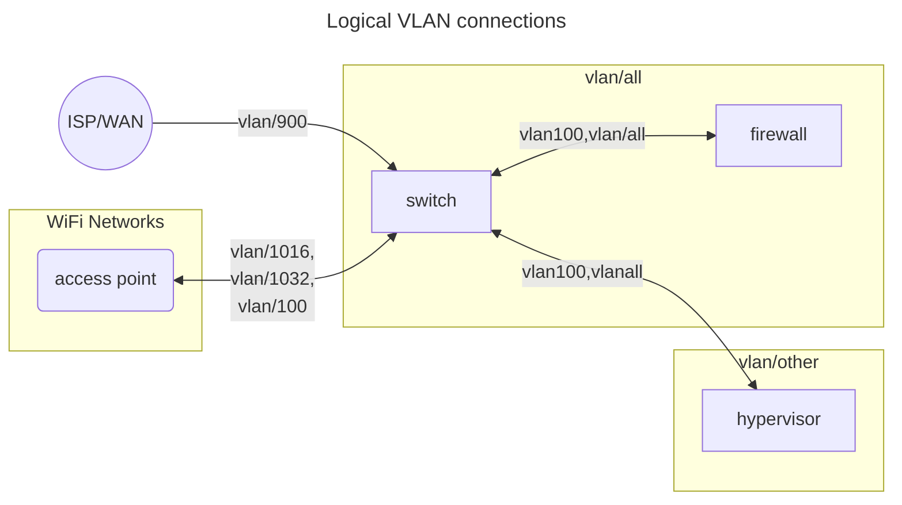
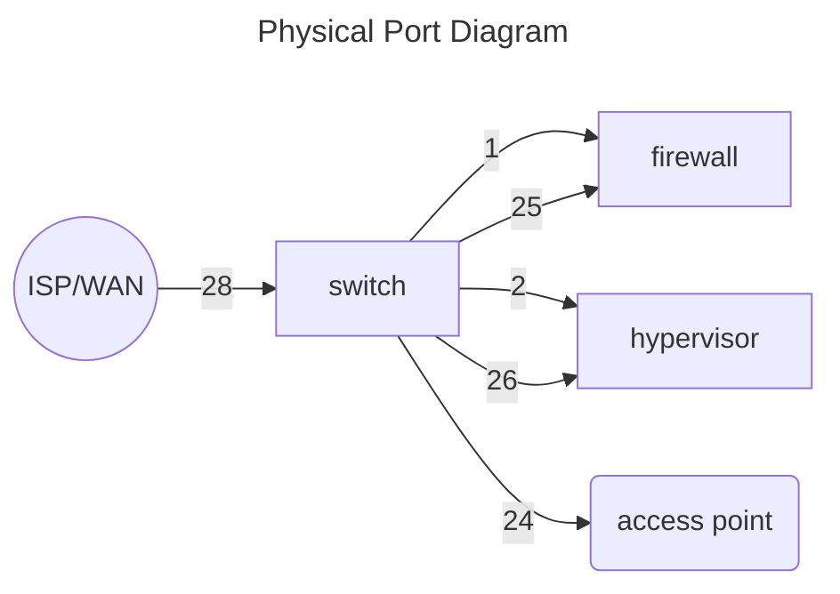

# Physical and Logical Architecture

This post continues from [Home Networking 1](/network/home/home1).

# Brief VLAN legend
The vlans we're using for now are established like so:
| VLAN | Purpose                          |
| ---- | -------------------------------- |
| 1    | untagged                         |
| 100  | Infrastructure management panels |
| 900  | Inbound ISP traffic              |
| 1016 | Trusted network                  |
| 1032 | Guest network                    |

# Logical Layout

Recall from earlier we mentioned [Router On a Stick](https://en.wikipedia.org/wiki/Router_on_a_stick), implemented thusly:

ISP modem goes into the switch, which in turn goes to the firewall. The ISP modem is an SFP unit, so it goes into one of the switches SFP+ slots. From there, a different switch-inserted SFP+ module connects to an SFP+ module on the firewall, over 10GB optical cables.
The optical cables we're using are "LC UPC Duplex", meaning there's one dedicated line for outgoing, and one dedicated line for incoming. Things can, in theory, go very fast on the internal network.

Once network packets pass through the firewall, they go back out into the switch to their destination vlan device.

ISP packets come in on a port marked for vlan 900. This is a standard marking for ISP / inbound-WAN traffic. Once it gets to the firewall, it will be sent back through the switch with whatever vlan is appropriate, defined by rules we will discuss later.

# Physical Layout

Because our vlans are traveling over a physical switch with physical ports, we can't just define the vlans in the opnsense firewall, we also have to define them on the switch. 

On our 24 Ethernet / 4 SFP port switch, we have roughly the following layout:
* Ports 1-12 (`1/1 - 1/12` in FS switch parlance)  (ethrenet) -  `untagged*`, meaning that anything plugged into them is capable of being routed anywhere. This is done for management purposes, therefore anything plugged into this set of items should be for device and infrastructure management.
  * \* "Untagged" in a vlan-aware system implies `vlan/1`. Don't ask me why.
* Port 1 (1/1) - dedicated to the Managemnet interface of the Firewall. This provides us with direct access to the OPNSense control panel / CLI.
* Port 24 (reserved) - for future expansion, this is marked as being a Trunk (aka, capable of carrying multiple vlans) carrying other, yet to be defined vlans, which is meant to be connected to a yet-to-be-installed second switch. This is meant to allow us to drop in another switch onto th network if we run out of ports on our current one.
* Port 25 (SFP+/fiber) - the actual switch<->firewall traffic. This port is makred as being a trunk for every for every single vlan (EXCEPT vlan/100 management traffic) we define on the network. This is necessary because we want _all_ traffic to flow through the firewall.
* Port 28 (SFP+/fiber) (`1/28`) -  `vlan900` for ISP traffic, and is where the ISP's SFP+ WAN modem unit is plugged into.

Or, in table form:
| Port | VLAN       | Notes                                |
| ---- | ---------- | ------------------------------------ |
| 1-12 | untagged   | For infrastructure access            |
| 1    | untagged   | Firewall management                  |
| 2    | untagged   | Hypervisor management                |
| 23   | 100        | Access Point* traffic                |
| 24   | Trunk, all | Reserved for future switch expansion |
| 25   | Trunk, all | Firewall traffic                     |
| 26   | Trunk, all | Hypervisor VM traffic                |
| 28   | 900        | ISP WAN access                       |

The other ports will be filled in later

*the Access Point requires some """flexibility""" in our system because it only has one port, meaning we have to combine our Management and Client traffic over one port using multiple VLANs on one port. Ideally we would have had two ports, one dedicated for management, and the other for client traffic. It gets a little tricky, and we will discuss this later. 

The actual physical port diagram looks like this:

As you can see, the AP only having one port breaks the pattern a little bit, but we can work around it.

# Underlay/Overlay
The network that we're going to set up is going to that of an Underlay Overlay network.
The `underlay` is where the network infrastructure will reside on its own internal RFC1918 IPv4 address space. Things on this space will have free access to both other things on the underlay, and to things on the overlay. Things on this network are variably on vlan 100, or untagged. Addresses on this this network will for things like the switch, the firewall, etc.

The `overlay` network is where everything that isn't direct network infrastructure reside, such as settop boxes, iot devices, and user accessible VMs. The address space is also an RFC1918 address space, but deliberately separate from the underlay one. This overlay network is extenseively vlan'd to achieve high separation.

For our purposes, the IPs we choose will be as follows:

| Network  | Address Space |
| -------- | ------------- |
| Underlay | 172.30.0.0/16 |
| Overlay  | 10.96.0.0/16  |

We choose a /16 CIDR so that we can make liberal use of the third ipv4 octet. Because this is going to be a relatively small network, we will end up using that third octet to denote the vlan of the network. This is not mandatory, but it has two nice side effects:
* The network is easily categorizable at a glance
* Networks will not have any overlap with each other in the event they need to perform cross-talk.

  Of course. this setup limits us to 256 addresses per vlan, but that's fine for our purposes.

