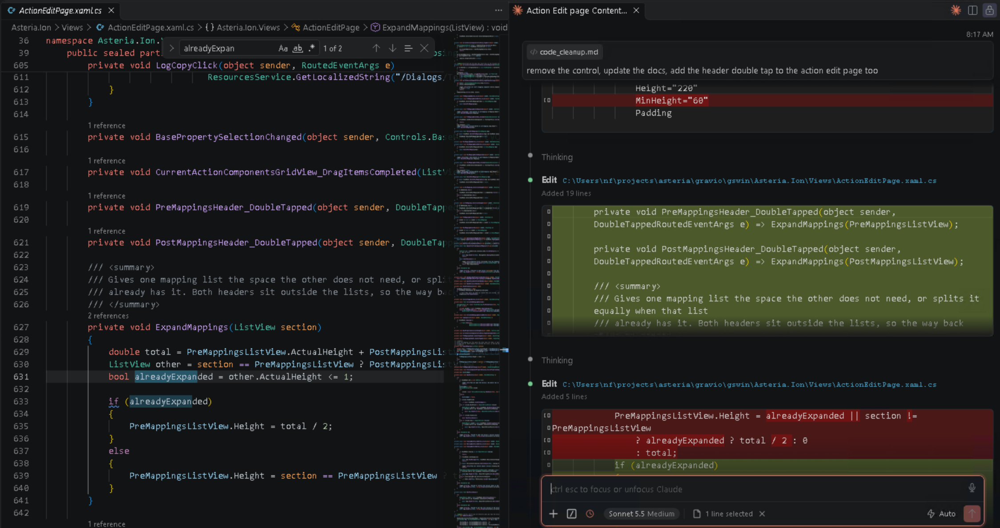

# tl;dr:
This post describes my first current very rough approach to agentic development.
This approach is heavy on docs, folder structure, and copipus tools and scripts for verification feedback.

My current approach is codified by the [Winetech Standard Repo](https://github.com/0xNF/wtstandardrepo), which is a barebones skeleton of the structure and built-in agent ready documentation to get started on a new project.

## Actual Take-Aways
* Use ADRs
* Prune memories, AGENTS.md, and other context-filling documents regularly
* Provide a space to put observations found during their tasks so don't get distracted and information doesn't get lost
* Keep as much inside the repo as possible, to provide agents with the context on demand that they need
* Provide tools and scripts that can give negative feedback to the agents so they can quickly course-correct on their own
* Give them a runtime of your application to test against in a live setting. Static analysis not enough.




# Prerequisites

People get different results from the diffeent workflows, tools, models and harnesses they use, so I'd like to set out what my partifuclar set up looks like at the outside, so you can adjust your own expectations.

## Models
* Big Models
  * (Primary) Claude Opus 5.5 (xhigh)
  * (Secondary) GPT Sol 6.1 (xhigh)
* Fast
  * (Primary) Claude Sonnet 5.5 (medium)
  * (Secodary) GPT Terra 6.1 (medium)

I have previously experiemmted with Mistral, and have only heard good things but not yet tried DeepSeek, GLM, or Kimi.
  
## Harnesses
* Claude Code
* [OhMyPi](https://github.com/can1357/oh-my-pi) (omp).

Be aware that I live 90% of the time in VSCode, so I also use the the [Claude Code Visual Studio Extenstion](https://marketplace.visualstudio.com/items?itemName=anthropic.claude-code) which I like because I can have rich markdown and code editing support side by side with the LLM output, like this:



However, I also like _omp_ because it has Language Server support built in, so it can do really efficient and thorough symbol renames, etc.

Because Anthropic doesn't permit using their Max subscriptions in other harnesses, _omp_ only get used when I need to use OpenAI's models. 

## Subscriptions
* Anthropic Teams Max Subscription
* OpenAI GPT pay-as-you-go pricing

Because of this set up, I prefer Claude because my usage is much less restricted. However, due to Anthropic's removal of some "bonus tokens" they've been giving out for a while, I am now routinely getting rate limited around Thursday, so it's become common for me to end by week in _omp_ with GPT Sol.


## Project Ownership
I largely possess autonomous control over how I approach my repositories, so I can structure them however I choose. The descriptions below may not be feasible in your own setups, due to team size, code review requirements, managerial processes, etc. But maybe some of the things herein can still be useful.


# Folder Structure
LLMs love to have context, and to have access to more context, so I have a folder structure with some initial files that seem to be working for me.

I won't explain it in full here, but you should check out my [Winetech Standard Repo](https://github.com/0xNF/wtstandardrepo) repo lays out much of how I've started to structure my repositories these days.

In brief, it takes the following shape:
```bash
.
├── docs
│   ├── repo
│   │   ├── adr
│   │   │   └── 0000-adr-format.md
│   │   ├── investigations
│   │   │   └── README.md
│   │   ├── misc
│   │   │   ├── architecture.md
│   │   │   ├── debugging.md
│   │   │   ├── history.md
│   │   │   └── README.md
│   │   ├── plans
│   │   │   ├── inprogress
│   │   │   ├── README.md
│   │   │   └── unimplemented
│   │   │       └── backlog.md
│   │   └── workflows
│   │       └── README.md
│   ├── tickets
│   │   └── README.md
│   └── vendored
│       └── README.md
├── README.md
└── repotools
    ├── public
    │   ├── go
    │   ├── python
    │   └── rust
    └── README.md
```

Each folder gets a README.md explaining its purpose, and what it's subfolders are for. For example, here is the main `docs/README.md` file, abbreviated for including in this post:
```markdown
# Docs

The front door to a project's documentation. It says what lives where and points to the separate rules file and the scripts README.
Vendored documentation is available in `vendored/`, so that agents don't have to go to the Web to learn about the details of their dependencies.

## Main documents

Standalone reference documents, listed in a table: a map of the system as it is, a symptom-first debugging index, a history of what was removed and why, rules for code that must survive a special compile step, a design and style guide, and an end-user guide that may lag the code.

## Workflows

Step-by-step procedures, one file per recurring task. They cover building and testing, running and driving the app, reading logs, releasing, and querying a local backend. They also cover guides for risky kinds of change and one page per automated check script.

## Architecture decision records

A numbered log of significant choices currently in force, each with its context, alternatives and consequences. Records are edited, replaced or deleted, never marked "superseded". Reversed designs go in the history document.

## Plans

Work in flight, written when work starts and deleted when it ends. One standing backlog collects problems noticed in passing, so they get recorded rather than fixed unprompted.

## Investigations

One folder per problem whose cause is still unknown. It holds the symptom, dated observations, open and ruled-out causes, and next steps. It is deleted in the same commit as the fix.

## Tickets

Defects and requests for code owned by other teams, filed one per file by owning component. Each ticket carries a priority (High, Medium or Low), a category, a validity note and verification evidence, and checks must not damage shared test environments.
```

Each header is important in its own right, but I want to note that I have gotten a disproportionate amount of value from the following items in particular:

## `adr/`
I took this from a Hacker News post a few months ago, and although I'm using the traipsings of Architecture Decision Records, I am using my own, perhaps cursed, flavor of them. I have dropped the `status` portion, because in my world, they're always `accepted`, and my standing rule is that they are always edited-in-place, never obsoleted. If an ADR exists in the repo, it is an active document.

I use them to record bite-sized facts about the repo in question. Here are a sample of ADRs in a few projects I am working with right now:

These are from a C# desktop application:
```
0002 — Layered MVVM application architecture
0005 — Use NotifyingObject for change notification
0024 — A message is a copyable dialog or a toast, and every message is kept
```

This is an AWS deployment:
```
0001 — OpenTofu for Infrastructure Provisioning
0008 — Layered Internal PKI: Offline Root + Online step-ca Intermediate + Short-Lived Auto-Renewed Certs
0012 — OpenVPN, IPv6-Only Split-Tunnel, Certificate-Only, tls-crypt-v2 Hardened
```

and it goes on like this. You can reference my standard [ADR baseline documen.](https://github.com/0xNF/wtstandardrepo/blob/master/docs/repo/adr/0000-adr-format.md).

Because these ADRs are so often references by the models, I endevaor to keep irrelevent information like History out of them. History is still important to maintain, so history goes into its own dedicatd history.md file.

The models really do reference ADRs all the time, and its been such a superpower that keeps them on track and consistent. It also catches my own inconsistencies, where the models will tell me that my own decision contradicts ADR #XYZ, which is a good moment for me to reflect on what I really want from a given session.

ADRs are not considered static -- I edit them in place, and occasionally delete, reorganize, or adjust them as needed. 


## `investigations/`
Sometimes a problem is found during a session, like an intermittent crash. It is helpful to provide the agent a place to put repeated observations of an issue along with a summary of the issue in the investigations readme file. Once enough observations have been logged, it becomes its own dedicated session and can be used as the starting point for a full-on investigation. The benefit of doing it this way is that the agent won't get distracted during a session, can recognize known failurs, and eventually can work on this one problem full-time.

here are some example ongoing investigations I have open in one of my desktop applications:
```bash
./
├─── action-editor-hangs-on-load-and-selection
│       README.md
│
├─── studio-fails-fast-returning-to-actions-list
│       README.md
│
└─── studio-process-outlives-its-window
        README.md
```

And a brief excerpt of what one such readme looks like:


```markdown
# Studio's process can outlive its window and hold the layout

**Status: open.** Seven sightings of a stuck exit or windowless process between 2026-10-03 and 2026-10-18, and four timed closes on 2026-10-07 that did not reproduce it. The cause is not known. The leading candidate is a clipboard flush at exit, and it has not been tested. A fifth sighting, on 2026-10-09, was a start that failed and never exited, which has a known cause of its own.

## The symptom

A Studio the user has closed stays alive with no window anyone knows of and one thread left, waiting in the kernel (state Wait, reason UserRequest). While it lives it holds the layout: refreshing it fails on `gs.dll` (robocopy exit 10), and `Add-AppxPackage -Register` fails with `0x80073D02`. Nothing on screen says why.

## Observations

| Sighting | Started                      | Remote Desktop | Copy before close | Threads, handles, memory | Exit code | Dump |
| -------- | ---------------------------- | -------------- | ----------------- | ------------------------ | --------- | ---- |
| 1        | 2026-10-03, how not recorded | not recorded   | not recorded      | 1, 918, 237 MB           | not read  | none |

### Sighting 1 -- 2026-10-03: alive eight minutes after its close

A Studio the user closed stayed alive for more than eight minutes.

## Candidates

### Ruled out
[...]

### Open
[...]
```

## `tickets/`
Tickets are where defects, feature requests, and larger behavioral changes go. I have outstanding instructions for agents to create tickets for items they've found during their sessions into this folder. The subfolder structure is less defined, but I currently have them organized by owner. For example, big items that are found in _this repository_ are placed into `$projectName/`, while defects found in, for example, the backend repo thats owned by another team, goes in `dependencyName/`.

For example:
```bash
.
├── desktop_app/
│   ├── camera-reset-keeps-selected-profile.md
│   └── maintenance-max-log-days-drifts-on-disk.md

├── upstream_dep1/
│   └── trigger-condition-schema-disagrees-with-the-hub.md
└── README.md
```

 The structure of my tickets here are also fluid, but I'm currently using this format for a ticket:

```markdown
Reset leaves one setting in place

## Assessment

- **Priority:** Medium
- **Category:** Correctness
- **Validity:** Confirmed
- **Assessed:** <date>
- **Basis:** Reset promises the default state but keeps a manually chosen setting, so a bad choice can't be undone by resetting. Picking "Auto" explicitly still works as a workaround.
- **Verification:** Confirmed by reading the source: the reset path applies defaults to every field except this one, and the code that reads the setting still honors any stored value. The API docs describe reset as a full restore with no exceptions. Not reproduced live, since no test device was in the required state.


what the upstream system does:
  Reset restores most fields to their defaults but skips one. A device pinned
  to a manual setting comes back from a reset still pinned, while every other
  field in the response is a default.

what we need:
  Reset should clear that setting too, so the result matches a fresh
  registration. If that isn't wanted, the docs should say it's deliberately
  excluded.

impact:
  A device pinned to a setting that no longer exists can't be recovered by
  resetting it. It keeps failing, and the reset control reports success
  without touching the field that matters.

evidence:
  The default-setting function covers six fields and omits this one. It's
  called from the reset handler. Other device types have no equivalent
  setting, so only this type is affected.

workaround on our side:
  None. The UI redraws from the reset response, so it shows the setting that
  survived instead of hiding it. Users can still select Auto and save, which
  does clear it.

once fixed, on our side:
  Nothing. The UI already renders whatever the response carries, so it will
  show Auto on its own.
```

The categories I'm using belong to the set of

 `[Usability, Security, Correctness, Misc, Feature]`.

Occasionally I will request the agents go through each filed ticket and re-assess whether it's still true or not. 
The purpose of this ticket structure is that it outlines clearly why this is an issue, and what this current repo is doing to work around it. 


## `backlog.md`
One item I've gotten a disproportionate amount of value from is the backlog.md file, which is the scratch space I provide to agents for them to put down small bugs, discrepencies, or things that need adjustment. This is similar to tickets, and indeed, until I decided that the tickets folder should also include the repo itself, is where feature requests and large changes went into. But after separating the two, this file is still very useful.

When an agent is working, it will often encounter problems. Depending on the agent, it may get distracted trying to solve them, or it may just forget about the issue by the end of the session. To make sure that this information isn't lost, they have standing orders to note any such defects into the backlog.md file immediately, and then to continue the main assigned work. This keeps them on task, and ensures that I have a decent accounting of bugs in my code. 

Not everything they put in is necessary, so it is worthwhile to manually prune the file from time to time, but by and large, the defects that Claude and GPT find have been worth addressing.

The format of my backlog file is like so:

```markdown
# Code cleanup backlog

Things found while working on something else: dead code, latent defects, and behaviour that looks wrong but was left alone because fixing it was outside the change at hand. Nothing here is blocking. Each entry is a decision for the user, not a task already agreed.

**Add to this file rather than fixing in passing.** When a change turns up an unrelated problem - an unreachable class, a notification that reaches nobody, a leak, a binding that has never worked - write it down here and carry on with the change you were making. Say what it is, where it is, what it costs to leave, and what fixing it would change. If you do fix one, delete it from this file.


# Methodology
- Consider breaking tasks into sub-tasks 
- You have a dev deploymemt of the application on this box and permission to use and modify it;
- [...]


# Backlog

## Release dependencies report unresolved trim and AOT analysis warnings

The 2026-10-16 x64 `just build aot` run succeeds but reports IL2104 for `WinUI.TableView`,
`Common.Logging`, `Microsoft.Data.SqlClient`, `Microsoft.Data.SqlClient.Internal.Logging`
and `System.Configuration.ConfigurationManager`, and IL3053 for `Microsoft.Data.SqlClient`.
ILC also says `Makaretu.Dns.LinuxHelper.ReuseAddresss(Socket)` always throws because
`Tmds.LibC` cannot be loaded. No runtime failure was observed from these diagnostics; leaving
them unresolved makes the Release build's analysis inconclusive for those dependency paths.
Triage would inspect the detailed ILC diagnostics, determine which paths the Windows client
can reach, and update or root the affected dependencies rather than suppressing the summaries.

[...]
```

I've found that the agents are exceptional at filling in this file, and on later dedicated passes, are equally exceptional at churning through it.

Many ADR discrepencies, usability problems, and bad bugs have been found this way, all without the agent getting distracted.


# Verification and Feedback
Agents work really well when they can correct their own assumptions in realtime. They react very well to negative feedback when they try something, such as compile-time failures or other errors that show them they had something incorrect.

You should encouage this by building and supplying tools that the agent can call. This can be as simple as supplying the language server for it to see diagnostic information in, or as complex as a custom constellation of scripts that do work in advance. For instance, in a desktop application, I have a series of scripts that check for banned APIs, or that certain structures aren't used:
```bash
.
├── check-serialization-contracts.ps1
├── check-source-rules.ps1
├── check-tooltips.ps1
└── check-window-ownership.ps1
```
Among manny others. The tools provide output like:
```bash
2 failed: 
Invalid API: src/models/ModelA.cs:76
{Binding} instead of {x:Bind}: src/views/LogView.xaml:862
```
which tell the model where one of its assumptions went wrong, and what it needs to correct before continuing.

## Repo Tools
In addition to tools that provide feedback, it's also useful to supply tools that give functionality that the agents keep writing for themselves. 
For instance, I noticed that the agents kept ad-hoc writing scripts to uninstall and reinstall an application, so instead of letting it waste tokens, and each time doing it slightly differnetly, I gave it a script that does it, consistently, every time. Now it knows to call `install_newest.ps1` and it will wait for it to finish before continuing.

It pays to pay attention to what the agents are doing, to work alongside them.

# AGENTS.md and Memories
A good AGENTS.md (née CLAUDE.md) file is mandatory for giving agents the initial overview and philosophy of your repository. Everyone knows this, so i won't spend muxh time on it here.

## AGENTS.md
In my case, my AGENTS.md contains things like:
* a brief overview of what this repo hopes to accomplish
* The toolchain used for building and deployment, with references to `building.md` for details
* The style guidelines with references to `style.md` and `adr/` for details
* The instructions for code backlog, ticketing, and investigations, with references to the appropriate README.md files
* Other tools available on this dev box, like whether Python, ffmpeg, curl, imagemagick, etc are available


## Memories
The purpose of memories, as distinct from AGENTS.md or specific repo tooling is that it is meant to represent things that are not globally applicable. 

Agents will often collect memories on their own, but sometimes its useful when you see persistent errors being made to encourage them to create memories under your guidance. Since I do a lot of work on Windows, and Agents have a not-unreasonable expectation that they're in UNIX-land, I have make sure they have memories that relate to setting BOMs, and that the editors they often use eat backslashes and need different escapting rules. 

I also use memories to give agents standing permission to do code commits, to make changes to the running development system, where to find temporary data, and what other nearby relevant repositories and documents are located that may be useful for the agent to be aware of.

These things are not global, and not applicable to other developers on this repository, so it's not appropriate to put them into the repo-permaent AGENTS.md. 

> A side note: It _is_ permissible to make tooling around these specific assumptions by using the `repotools/$username/` folders, which is where developer specific tooling should go. There is no expectation that tools under your own folder are useful, or indeed even run, under any other user. Repo-wide tools should graduate into the `repotools/public/` folder. 
> 
> This is why I think there's a large synergy to be had with the repo tools folder in an agentic setting.


## Skills
I have not generally found skills to be very useful. I have nothing in particular to write here on the subject.


## Pruning files when they get too big or outdated
Token budgets are not unlimited, and context size must be managed. To that end, one must consider on occasion to revisit the files you are asking the agents to work with on every request.

AGENTS.md should be kept under `10,000` tokens, and even that is pushing it. Remember that this is sent on every request. It is worth looking at what needs to be understood all the time, versus what only needs to be understood some of the time, versus what doesnt need to be understood at all. 

If assumptions are outdated or have conflicting instructions, delete them. If things only apply some of the time, extract those sections to their own ADR or Workflow documents, and then put a reference in instead. 

As simple as it can get, but no simpler. 

The same rules apply for your memory files, which can be found under `~/.claude/projects/$project/memory`, or other similar harness-dependent locations. 

Condense, Extract, Delete. 

# Working with the Agents

(LLM, Harness) pairs have their own runtime quirks and should be worked with the way a craftsman knows how to work with a powerdrill that whirls in one direction faster than the other, a hammer that isn't perfectly flat and thus has slight directional preference, or a car that has a very delicate accelerator. The quirks are worth learning and using to your advantage. Don't fight the agents, work with them.

## Prompting Style
Because I have what I consider to be fairly well crafted initial documents and on-demand context available for the agents, I don't put too much effort into my prompts, which are concise and minimal.

* "Read this $document, and address the issues"
* "Fix the bugs describes by the cleanup"
* "Continue working on this plan file"

Except in rare circumstances, I don't write any additional context, because I've already given the context in the AGENTS.md, ADRs, and plan files. 

Sometimes I have questions that require a more thorough examination before we can continue:
* Extamine the feasability of adding the following feature to this application, and consider how many dependencies it would require to accomplish
* We are currently doing $X in our application, but I want to move to $Y instead, write a plan file for this process

I have found it productive to speak in mechanical, precise terminology. I do not abridge my requests, use shorthand slang, or speak casually with the agents. I do my best to give them accurate and clear phrases to work with. It helps to orient their initial manifolds when you say things like "Consider ahead-of-time compilation issues", or "profile this slowdown and find whether a different algorithm should be used for this subroutine", instead of "why is it slow" or "u should find the bug". LLMs are often reflections of the tone and skill of the user prompt, and if you are sloppy in your input you will find it is sloppy in its' output. 


## Corrections
Sometimes the Agents are confident in their assertion that some things cannot be done. It may be the case that you know better than they do - in those situations it is important to supply them with relevant documentation, at which point they will happily change course and begin working.

Remember that they have cut-off dates for their training, so they will only recall information up to that point. Any change in status of something that happened after that date needs to be supplied to them.


## Lean into their biases and expectations for tools and docs
Like said above, LLMs have quirks, biass and expectations, If you watch them long enough you'll pick up this fact because you'll see them say things like "That API doesn't exist, I'll try a different one", or "Turns out ffmpeg isn't found on this machine, so I'll write a small script in python instead".

These are opportunities to do two things:
* Make your token usage more efficient
* Make your tools better
  
Every time they backtrack on a choice is tokens that you're spending, time you're wasting, and context you're eating up. Not all situations are equal, but on balance, you should consider adding what they're expecting to your tools and your environment. They will be more competent in their tasks when they have what they want without the fuss of trying to work around it. They are also trained on those aspects, so they'll be good at using them.

Additionally, especially when it comes to API surfaces, misaligned expectations are a solid indicator that your API deisgn is lacking in crucial ways. If your agent is making these mistakes, other people's agents are also making the same mistake. And human users may also be under same misapprehension. It is worth considering deeply whether the design the agents expected is actually a better design -- very often, it is. 


### A brief methodology
I recently went through my Claude session transcripts of the past month with another agent (GPT-Luna-6.1 via _omp_ because I was at my weekly Claude token limit at that time) with the instructions to:

> "Read these session transscripts and find instances where the agent got confused, backtracked, realized a tool or program was missing, or used an API with an incorrect shape".

The results were a useful set of places to start working some immediate remediation candidates. I was able to update a handful of checker scripts in the repo, and also file some tickets against a sister repository for improvements this way. Here are some samples of what that scan turned up, and the resolution I opted for.
```markdown
1) 
    - Expected: ffmpeg to be installed to change the encoding a screenshot
    - Actual: not installed, wrote a python script to adjust the encoding by hand.
> Resolution: install ffmpeg

2)
    - Expected: The same test date could be reused across pages.
    - Actual: The user clarified that Data Viewer needed September to get real data.
> Resolution: Add a script that seeds test data before certain diagnostic runs

3)
    - Expected: gsdrive can resize windows and click any named UI control.
    - Actual: It had no resize verb, resized by using pointer and click APIs manually.
> Resolution: Added a `resize` verb to the automation tooling
 ```
  
## Hooks and notifications
Agent harnesses have started to support [Hooks](https://code.claude.com/docs/en/hooks), which are a standard comcept, just applied to this new tech. 
Because I do most of my work in a Windows VM through a Linux host, and a lot of these tasks are long running, I am often delayed in returning to a session to assess output or answer questions. To address that problem, I built a [KDE taskbar widget](https://github.com/0xNF/vm_llm_notify) that receives hooks from Claude Code. The taskbar widget lights up whenever an inner VM session is waiting for my assessment:


## Paralleization
Sometimes I want to get multiple things done in one repo, and don't want to wait for a single agent to churn through the tasks sequentially. 
If I have a set of tasks that I think are decent candidates for doing in parallel, as in, they touch different files and wont step on each other's work, I open multiple panes of Claude Code and set them to their tasks. The first thing I writ in these prompts is:

> You are working in parallel with other agents in the same checkout of this git repo. Coordinate with each other as you work.

I don't know about other harnesses, but for Claude Code, this works very well. The agents will then Post and Receive messages to each other, sharing their file lists, seeing who has the next build pipeline and if they can piggyback off it, taking turns driving the application test suites, and generally doing a good job together. In extreme cases the agents will often decide to make a new git worktree and rebase their changes onto the main delegate branch. 

I've found that I only have the mental capacity to kepe track about 4 agents at once, after that I begin to lose the ability to keep accurate tabs on their motion, and risk each agent going a bit off the rails. 


# Some Usage Patterns
Here are some patterns of interaction I have and employ with this generation of agents.

## "Wrap up"
This seems to be a keyword that the frontier models are highly trained on. "Wrap up" means to them that they should finish their work in a good stopping place, and relinquish their turn. Eager agents that normally consume work items will pause, tidy up their solution, run one final test suite, and then leave the turn for the user. This is very useful in combination with the next item, the handoff document.

## Handoff Documents
When context starts getting too packed, especially on long-running tasks that require sustained attention, I ask the agent to wrap up and produce a handoff document.

Handoff documents were a concept pioneered by the local agent harness crowd like the Pi harness, and has started to see adoption in other harnesses. 

The idea is that the this agent will stop working, and a new, fresh agent will pick up the work. We don't want to start with the main plan file, which has too much context, and has an unclear current-position. The handoff document exists in tandem with the plan file and represents the current state of the implementation, plus what a new agent needs to to know to immediately pick up the work where it was left off. 

n conjunction with the `plans/` folder from the above folder structure, a simple, sequential use of agents will produce a raw `handoff.md` file in the `plan/` directory, and a complicated plan will get its own dedicated folder with its own handoff document. 

`handoff.md` is a very temporary file, and is either constantly being rewritten depending on how extensive and token-intensive the task is, or just straight up deleted when no longer needed. 

This goes hand-in-hand with the next item, "rewrite to be forward looking". 

## Rewrite To Be Forward Looking
Plan files and Handoff files often get polutted, as time goes on, with historical state of the repsitory and the plan being implemented. Lots of:
* (Done) Some Requsiite Feature A 
* (Done) Some Requisite Feature B
* Previously we had bugs in Set A, but I fixed it for and Set B is now unblocked
* [,,,]
  
  and similar things. This is a quirk of the LLMs that may useful to them in the moment, but for new agents picking up work, is entirely unnecessary. At some point in becomes the prudent choice to tell the agent to 
  > rewrite this document to be foward looking

"forward looking" is a keyword taken from my observations of Opus. It often uses that phrase when it deletes old content, so I adopted it into my vocabulary to better trigger the behavior I'm loooking for. 

At the end of one of these requests, we get documents that are pruned of old detail, and only contain the necessary bits that are yet to be implemented. The agents are also smart enough to retain the items that are historical but highly relevant, like traps in the API or gaps in the machines expectations. 

Of course, you can always give these documets a manual once-over with your own eyes to see if they left any details in that should be stricken. 

## Team A vs Team B
I have dominion over a number of repositories that are interlinked at various levels to each other, and I often have VSCode windows up and agents working on those repos simultaneusly. Sometimes, features co-develop across repositories and require two agents across repos to work in tandem. 

When this happens, I have Agent A in Repo 1 (1.A) work on some core feature, then ask for an Implementation Document for Agent B in Repo 2 (2.B). 
Then, I take that document, and give it directly to 2.B. Sometimes it becomes emergent that the feature set or details of the core project are missing something. To prevent 2.B from creating weird work-arounds or producing a sub-standard end result, I ask 2.B for a document outlining its requests for the Repo 1 Team, which it will write me, and then I can hand that document back to 1.A, which will address the issues, and the process repeats. 

This is a great way to get a really polished feature across two repositories simultanepusly. The agents are indirectly asking each other questions, refinidng their assumptions, and creating featuees, fixing bugs, or polishing the experience. 

I don't combine the agents into one singular one becaue at the context sizes I am working with, it's a lot easier and consistent to have each Repo Agent manage its own repo context. They can communicate to each other through me, and I can arbitrate their requests. Because ultimately, I am the consumer and the judge of their work product. 

I find this "Team A vs Team B" document passing to be really productive. 


# Recent Worked Examples

I'll describe some thigs I've had the agents do recently, beyond just the standard "implement this feature" and 'fix this bug" requests.

## Reducing Token Spend on Backtracking during Failed Test Runs
A Desktop GUI C# application has a dedicated test suite project. It's regular output contained all the successes and failures, but the failures were printed at the top of the output, and the agents have a habit of using `sed`, `trim`, and select-last in powershell, resulting in the test failures not being visible to the agent. What often happened is that it saw a generic failure (exit code 1), then re-ran the test suite with a new command just to get the failing test. 

The resolution was to reduce stdout noise and print detailed test failure output only, so the agents have visibility into the only part of the test suite that matters: whether a ran succeedd, and if not, which ones failed. As before, this saves tokens, context, and time.

## Test Suite Optimization
A perfect mix of three things that make LLM use optimal:
* A clear goal
  * > Bring the execution time of this test suite down to under 10 seconds
* A way to measure
  * `time` on the test suite executable
* Knobs to change
  * The test suite source code
  
With these three items an LLM can really go into perfect overdrive to improve an outcome.

In this specifi case, I was able to work with the LLM to iteraively reduce a naively built C#/XAML test suite from 5 minutes per run, all the way down to 10 seconds. The steps in between were 1 minute, 30 seconds, 16 seconds, then 8 seconds. 

The agent itself did a doggedly good job, but it was a tandem effort becaue I had to suggest paralleization and thread usage, eliminating old tests, and restructuring the project in ways that made it more amenable to testing.

## Automation and Accessibility
WinUI3, Microsoft's modern desktop framework, supports [Automation Properties](https://learn.microsoft.com/en-us/dotnet/framework/ui-automation/ui-automation-properties-overview), which, if you are familiar with puppeteer or playwright, permits API control of the program. In the agentic era, a program that an agent can use, is a program that an agent can improve.

The first problem was getting this application to have automation properties in the first place. The solution of course was to supply the relevant documetation and then set the agents on their first task: 
> Add automation propreties this application

Once that was done, an ADR was created saying that "all UI elements must have automation properties".

And finally, with it all in place, all future bug fix or feature implementation sessions can now be driven start to finish with the Agent all on its own, since it now has access to every part of the application. 

With vision capable models like the large frontier ones, an agent is now much more powerful and can make quite delicate judgements and assess its own work much more accurately, because now it can also drive the application on its own as well.

## Migrating a Failing Robotics Sample From Gazebo to MuJoCo
A book I am following for robotics was built with the simulation program Gazebo, so all the examples in it are assuming and utilizing that program. However, Gazebo is widely understood to be bad, unreliable, have issues starting up, often misses messages passed between program nodes, and is generally a pain. This matches my experience. Some elder robotisics I have spoken to, when hearing of my woes, told me that I should spend my time in other simulators like Isaac or MuJoCo. So I had Opus take all the book's example and move them into MuJoCo automatically.

It took about a week 12-hour days of time for Opus to churn through all the issues, but in the end, I had a proper simulator environent that had no runtime issues at all, and was very stable. 

