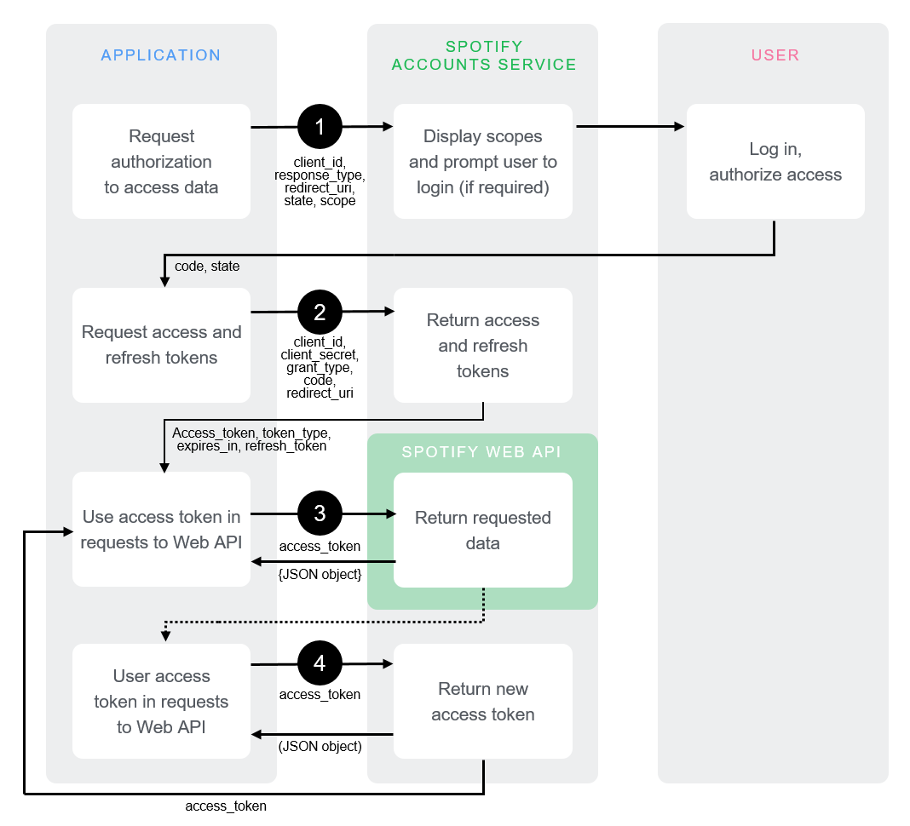

+++
date = '2026-01-05T22:58:37+09:00'
draft = true
title = 'Init'
+++

# Prologue
OAuth is a common peice of web technology infrastructure that underpins many common websites.
To keep things short, its how you log into websites.

But we're here to learn more than that. First, how much detail would you like to learn? Select a skill level, and we'll work from there.

n.b., we will only be covering OAuth 2.1 here, since OAuth 2.0 is now deprecated. That means no Implicit Flow, and Authorization will use PKCE only.
Also, we're going to be deep-diving into a bunch of RFCs, so depending on the experience level, be prepared for some technical writing.

<details>
<summary>

# Skill Level -1 (just the summary)
</summary>

[[Graph 1 -- the drawing of Login With X]]

It's when websites or apps ask you to "Log In With Google", "Log In With Instragram".
</details>


<details>
<summary> 

# Skill Level 0 (novice / just a random internet user)
</summary>


[[Get lots of pictures of OAuth here]]  
  
  
<div class="row-container" style="display: flex; width: 100%; height: 100%; flex-direction: column; background-color: blue; overflow: hidden;">
  <iframe src="/simple_auth_1/index.html" style="flex-grow: 1; border: none; margin: 0; padding: 0;" height="500"></iframe>
</div>


OAuth, specifically OAuth 2.1, though commonly just referred to as OAuth 2, is how things like "Log in with Google", or "Log in with Instagram" work. You already have an account with Instagram, so it's easier to just login with those credentials than to create a brand new login for yet another app.

When you select Log In With Google, you get redirected to Google's own log-in form. This form shows you:
* Who is asking for permission from you
* What they want to have access to / what they want to be able to do
  
After considering this form, you confirm or deny the Authorization Request, and then you get redirected back to the site you were trying to log into originally. There was a bit of a bouncing from hither and tither, but it worked well and now you're logged into the new website. 

This means:  

- The website _does not know_ your Google password
- The website _does not store_ your Google password
- The website _cannot_ login as you
- The website _cannot_ impersonate you
- The website _cannot_ do whatever it wants

Whats important to know here is that when you login _with_ Google, only Google knows about your password. The website doesn't know anything.
All it does is give the website access to specific aspects your account. What, specifically, it has access to was shown to you on the Authorization Screen.

For most purposes, the only thing you need to remember is that it reduces the amount of logins you need to keep track of. Instead of creating yet another account on yet another site, you can just use your Google account. 

</details>


<details>
<summary>

# Skill Level 1 (developer, but not too into web tech)  
</summary>
  
OAuth2 is how you login into one site with an account from another. It's designed to avoid sharing actual credentials such as passwords, while still letting you access things associated with your account on one service, while using a different service. One example of this would be [stats.fm](stats.fm), an app that shows listening statistics from your Spotify account. Stats.fm is not affiliated with Spotify, but it needs access to your Spotify account to work. When you log in, it asks you to "connect your Spotify account", which brings you to the Spotify login screen. There, you log into Spotify like normal, on Spotify's actual spotify.com domain, and then you get redirected back to stats.fm, with the redirect operation carrying some extra information. It is with this extra information that the app now has access to knowledge related to your Spotify account.  
  

[[Animation 2 -- anim including return of Access Token]]

### Access Token
This is accomplished by the acquistion of an _Access Token_, which is string that is sent back and forth between stats.fm, and Spotify. This string is assocated with your specific account and gives its bearer access to information associated with your Spotify account. It is functionally similar to a cookie holding login information. The contents of the string are intended to be opaque to users. The contents are not important, what matters is that the string is sent over to the server exactly as-is.

Whoever bears this token has access to everything the token was given access to during the initial Authorization. Because of this property, an Access Token, and all other tokens similar to it, are known as a broad category, as _Bearer Tokens_.  We will be referring to Bearer Tokens a lot, but just remember that a Bearer Token is a category of credential, and Access Tokens are a specific type of Bearer Token. 

Access Tokens are typically _short-lived_. What this means in practice is that access tokens have a lifetime of about an hour (3600 seconds, this number will appear a lot as well), after which the the token becomes invalid. Continuing to use the token will result in a lot of _403 Unauthorized_ errors.

### Refresh Token
So how do you get a new one if its expired? Does the user have to do another Authorization step? No, to get another Access Token we use something called a _Refresh Token_. When we got our original Access Token, a handful of other data was sent to us at the same time. One such piece data we got in addition to the Access Token was another token, called the Refresh Token. A Refresh Token's only purpose is to be given back to the main server. When we do so, the sever sends us back another Access Token, and another Refresh Token.

[[Animation 3 -- anim including return of Access And Refresh Tokens]]

</details>

<details>
<summary>

# Skill Level 2 (developer, in charge of integrating with an OAuth Provider)
</summary>


[[Animation 4 -- anim including the Auth Code, return, and exchange]] 


OAuth 2 is a set of specifications for supplying third-party applications with first-party  authorization ("authz", or "what you are allowed to do") information. What's important to know is that [OAuth 2.1[(21 RFC)] is the current main spec, and that it defines the Authorization Flow with PKCE, and the Client Credentials flow. There's also an extension to OAuth2 called OpenID Connect (OIDC) that deals with providing authentication ("authn", or "who you are") information. The difference between the two is often muddled.

OAuth 2 uses a standard set of terminology that one should be familiar with, otherwise it becomes confusing trying to understand what is talking to who and under what circumstances.
The entities commonly seen in the spec are:  


- Authorization Server
- Resource Server
- Resource Owner
- Resouce
- Client
- User 
- User Agent
- Flow
- Token

The spec defines treats these entities seperately, but oftentimes they can be co-located, making the distinction hard to grasp when thinking about it from the perspective of certain services you may have encountered in the wild.

### Working Definitions
You can find the true definitions in the spec, but let's outline them here:
- __Authorization Server__
	- This is the authority with whom you are trying offer "Log In With" capability with.
	- This is Spotify, Instagram, Google, etc, where the users actual account lies
	- Specifically, this is their `accounts.xyz.com` doman, as opposed to their generaic `xyz.com` domain.
	- From the perspective of OAuth, the Authorization Servers _only_ responsibility is providing access to user account checks.
	- Authorization Servers hold all the Resource Owners
- __Resource Server__
	- This is the server where "resources" are.
	- Typically, this is the `api.xyz.com` domain or the `xyz.com/api/` endpoint.
	- The resouce server does not Authorize, 
- __Resource__
	- A resource is anything that your integrating application might be interested in
		- Liked Songs
		- Friends List
		- Calendar Events
		- Product Reviews,
		- etc
- __Resource Owner__
	- This a term describing _whose_ things you're interested in
	- _whose_ Liked Songs?
	- _whose_ Friends List?
	- _whose_ Calendar Events?
	- From the perspctive of OAuth, the Resouce Owner is the literal user account on the Authorization Server. As a matter of philosophy, that means that a "User" and a  "Resource Owner" are the same abstract entity, represented at different concrete steps of the process.
	- A Resource Owner necessarily has an account on the Authorization Server
- __User__
	- The person trying to login, the person actually phsyically performing the button clicks to initiate the varius Flows
- __User Agent__
	- The user's Browser, or the Web View used to phsyically handle the Authoriztion process
- __Flow__
	- Flows are a little more abstract, but they represent the various different types of back-and-forth to obtain Tokens
	- the two major flows are _Client Credentials_, and _Authorization_
		- n.b, 1: Authorization used to be called "Authorization", and then an extension known as "Authorization with PKCE" was introduced, and then that got absorped into the main spec, so now it's just back to "Authorization".
		- n.b, 2: There used to be something called the "Implicit Flow". This is now deleted, and servers that continue to support it are out of compliance with the current specification.
- __Token__
	- A string that can be used to access the API servers on behalf of a user.
- __Client__
  - A specific application that has bene registered with the Authorization Server, and is permitted to receive and use Tokens.
  - From the perspective of you, a developer integrating with an OAuth Server, this is is _your_ application, that you have registered with the OAuth Server.

For reference, here is how the OAuth Spec depicts the main Flow

```
     +--------+                               +---------------+
     |        |--(1)- Authorization Request ->|   Resource    |
     |        |                               |     Owner     |
     |        |<-(2)-- Authorization Grant ---|               |
     |        |                               +---------------+
     |        |
     |        |                               +---------------+
     |        |--(3)-- Authorization Grant -->| Authorization |
     | Client |                               |     Server    |
     |        |<-(4)----- Access Token -------|               |
     |        |                               +---------------+
     |        |
     |        |                               +---------------+
     |        |--(5)----- Access Token ------>|    Resource   |
     |        |                               |     Server    |
     |        |<-(6)--- Protected Resource ---|               |
     +--------+                               +---------------+
```

As comparison, here's how Spotify depicts the same process:  



These graphs are as simple as it can be, but that doesn't make it necessarily _simple_.

</details>

# The OAuth Dance

The OAuth Authorization Flow is like a three-person dance between the user, your Client, and the Authorization Server.

You have to craft an _Authorization Request_ with specific parameters, then send both the user and that crafted request to the Authorization Server.  At this step, your Client must wait while the two other parties dance on their own for a bit.  

The Authorization Server uses that request to ask the user if they acquiesce to the request. If so, the Authorization Server gives your Client an _Authorization Code_, and then your Client is back in the dance.  

The User is now retired from the dance completely, and its just your Client and Authorization Server now.  

Using the _Authorization Code_, your Client hands the Authorization Server the same _Authorization Code_ it just received, and in return the Authorization Server hands your Client back an _Access Token_.  

At this point, the three-way dance concludes. The final result of the dance is the Acess Token, which you can now use to dance with the Resource Server, separately.

#
The dance is hard to understand in the abstract, and it's much easier to understand in motion. To that effect, you can see the dance happen with real information here: